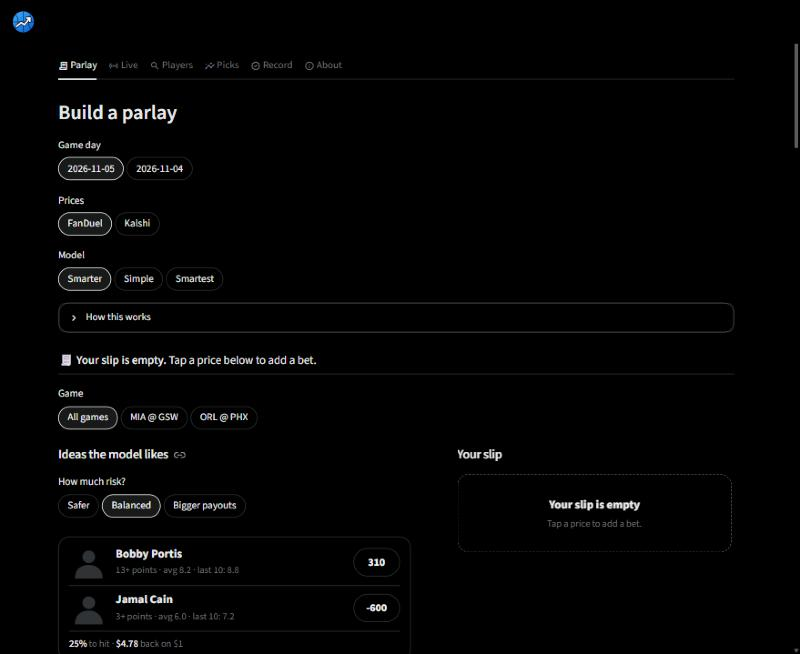
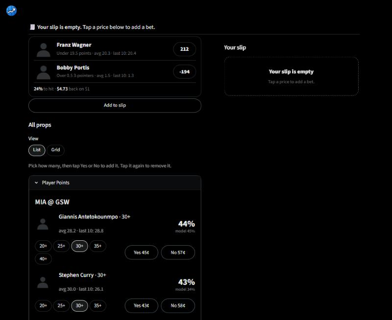
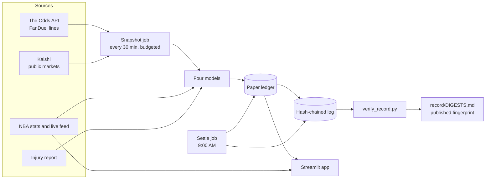

<p align="center"></p>

# Ball Knowledge

[](https://github.com/scottdmorris/edgefinder/actions/workflows/tests.yml)
[](LICENSE)

NBA player projections and a parlay builder, built to answer one question
honestly: **does a model add anything beyond the market's own price?** Every
line is priced by four competing models, paper-tracked in a tamper-evident
log, and graded against real results before anyone is asked to trust it.

<p align="center">
  
  
</p>
<p align="center"><sub>Player photos and team logos are replaced with neutral silhouettes in these screenshots.</sub></p>

## The record so far

The model is not claimed to beat the market. It has been tracked live since
2026-11-04, and this is what the record shows (FanDuel points picks, graded
at a flat 1 unit):

| Model | Graded picks | Record | Units | Beat the closing price |
|---|---:|---:|---:|---:|
| Simple (`ewma-v1`) | 20 | 11-9 | +0.75 | 50% of 14 |
| Smarter (`minutes-v1`) | 19 | 8-11 | -3.65 | 50% of 16 |

One game day graded, as of 2026-11-05. That is far too little to say anything:
it is a coin flip so far, which is the honest starting point. `Smartest`
(`context-v1`) priced its first night on 2026-11-05 and has nothing graded yet;
`Sharpest` (`context-v2`) prices its first lines with the next slate. The live
version is the Record tab; regenerate this table with
`python scripts/readme_results.py`.

## What is in it

- **Four models side by side**, each logged under its own version: a rolling
  average, a learned-minutes model, a model that also knows who is out, and a
  fourth that adds shot habits and sizes its uncertainty to each player.
- **Honest evaluation.** Walk-forward and leak-free: a game's own result never
  feeds its own features, and the tests enforce it. Model choices are made on
  one season and scored once on the next.
- **Parlay pricing that knows legs are linked.** Same-game bets are priced with
  a Gaussian copula using correlations measured from three seasons of logs,
  including how one player's points, rebounds and threes move together.
- **Two price sources.** FanDuel lines (The Odds API) and Kalshi's public
  prediction-market prices, with a FanDuel/Kalshi switch and a Kalshi-style list.
- **A tamper-evident record.** Every pick and result is written to an append-only
  hash-chained log, audited against the ledger, with a published fingerprint.
- **Live game center.** Scoreboard, shot chart on the home team's floor, box
  score, timeouts, fouls, and your slip tracked bet by bet.
- **Built to run unattended**, with job heartbeats, retries, and an app notice
  when snapshots fall behind.

## How it fits together



## Quick start

```powershell
python -m venv .venv
.venv\Scripts\pip install -r requirements.txt
.venv\Scripts\streamlit run app.py
```

Runs at http://localhost:8501. The app only reads files the scheduled jobs
write, so it works without an API key and never spends Odds API requests. To
record live FanDuel lines, get a free key at https://the-odds-api.com (500
requests a month) and put it in `data/odds_api_key.txt` (git-ignored) or the
`ODDS_API_KEY` environment variable.

```powershell
.venv\Scripts\python scripts\nba_props_snapshot.py --dry-run   # what is due; spends nothing
.venv\Scripts\python scripts\nba_props_snapshot.py             # one snapshot cycle
.venv\Scripts\python scripts\nba_props_settle.py               # grade picks, print the report
.venv\Scripts\python scripts\verify_record.py                  # check the log and the ledger
powershell -ExecutionPolicy Bypass -File scripts\install_nba_tasks.ps1   # schedule both jobs
.venv\Scripts\python -m pytest                                 # about 1,300 tests
```

## The six views

- **Parlay.** Every prop for a game day as stacked Points, Rebounds, Assists and
  3-pointer sections, filterable by game, in a list or grid. Suggested slips per
  risk style (each must pay enough to be worth the stake and hold a real leg),
  and a slip that prices the chance it all hits.
- **Live.** Scoreboard with a "+3" pop when a team scores, any game's shot
  chart, box score and plays, and your slip tracked while the games are on.
- **Players.** Search a player: averages, recent games, tonight's lines and both
  projections, and how often he has cleared a number.
- **Picks.** Suggested bets, X+ points ladders, and every line next to the
  market's devigged probability.
- **Record.** Whether the log is intact, whether the price moved our way after
  each pick, each model's record, accuracy against the market, and every pick.
- **About.** The method in plain language.

## How it works

The full explanation, with a worked example and the limits, is in
[docs/METHODOLOGY.md](docs/METHODOLOGY.md). In short:

- **Budgeted snapshots.** The free Odds API tier is 500 requests a month, so the
  job covers at most 6 games a night: one early snapshot 2.5 to 4 hours before
  tip (the price a pick is made at, after the injury report settles) and one
  inside 90 minutes (a closing-price proxy). A reserve stops it before the quota
  runs out. Kalshi costs nothing, so it is recorded alongside.
- **A projection becomes a chance** through a negative binomial whose spread
  depends on the size of the projection: a 6-point projection is far noisier,
  relative to its size, than a 25-point one. That change improved the log score
  about five times as much as the changes to the projection itself.
- **Chances are blended** 30% model and 70% the market's devigged price, because
  the raw model is overconfident and a parlay multiplies overconfidence.
- **The test** is whether a model's accuracy beats the market's own number on
  the same lines, and whether the price moves its way after a pick
  (closing-line value). Nothing is claimed before the record says so.

Measured offline, walk-forward, on 2025-26 after choosing on 2024-25:

| Step | Points error (MAE) |
|---|---:|
| Rolling-average baselines | about 5.2 |
| Learned minutes model | 5.137 |
| Plus who is out, opponent and pace | 5.108 |
| Plus shot habits and a blend | 5.090 |

Small, real gains against past games. They are not evidence of beating a
sportsbook, which needs the live record above.

## Verify the record yourself

The ledger is a spreadsheet, so it is also written to an append-only log where
each entry's SHA-256 fingerprint covers the previous one; changing any past
entry breaks every fingerprint after it. The latest fingerprint is published in
[`record/DIGESTS.md`](record/DIGESTS.md), where the commit time is a witness the
operator does not control.

```powershell
.venv\Scripts\python scripts\verify_record.py    # intact? does the ledger match?
```

It cannot prove the entries that existed when the log began (they were
imported and are marked so), and the time on an entry is the clock of the
machine that wrote it. Details are in the methodology document.

## Roadmap

1. **Evidence.** Weeks of settled results, with closing-line value, decide
   whether any model beats the market. Nothing is sold until that is known.
2. **Moneyline and game totals**, which need a team model; same-game bets that
   mix a player with the game's result are not covered yet.
3. **Accounts and hosting.** Needs a real database, a hosted scheduler, and
   licensed data (see below).

## Data and licensing

The code is licensed for noncommercial use (see below). The data it reads is
not covered by that license and has its own terms: The Odds API (the free tier
is for personal use), Kalshi's public market data, the NBA's stats and live
feeds through the unofficial `nba_api` client, and ESPN's injury report. Player
photos and team logos shown in the app come from the NBA's content network and
are not included in this repository. A public or commercial product would need
licensed replacements for all of these.

## An honest note on profit

Sportsbooks price parlays with compounding vig; most parlays are negative
expected value on average. The realistic path to any edge is betting only
positive-EV singles a model finds, sizing small, and judging the model by
closing-line value over a long run, not short-term wins. This project does not
promise a profit and is not betting advice. Never bet money you cannot afford
to lose. Problem gambling help: 1-800-GAMBLER.

## Development

```powershell
.venv\Scripts\python -m pytest
```

Layout: `src/edgefinder/betting` (odds, expected value, the negative binomial
and correlated-parlay math), `models` (baselines, minutes, context and shot
models, correlations), `data` (NBA, Kalshi and Odds API clients, job health),
`eval` (walk-forward scoring), `tracking` (ledgers, grading, the pick chain),
`ui` (Streamlit views and the theme). See [CHANGELOG.md](CHANGELOG.md) for what
changed and why.

## License

[PolyForm Noncommercial 1.0.0](LICENSE): free to read, run and learn from, not to
use commercially. Copyright (c) 2026 Scott Morris.
